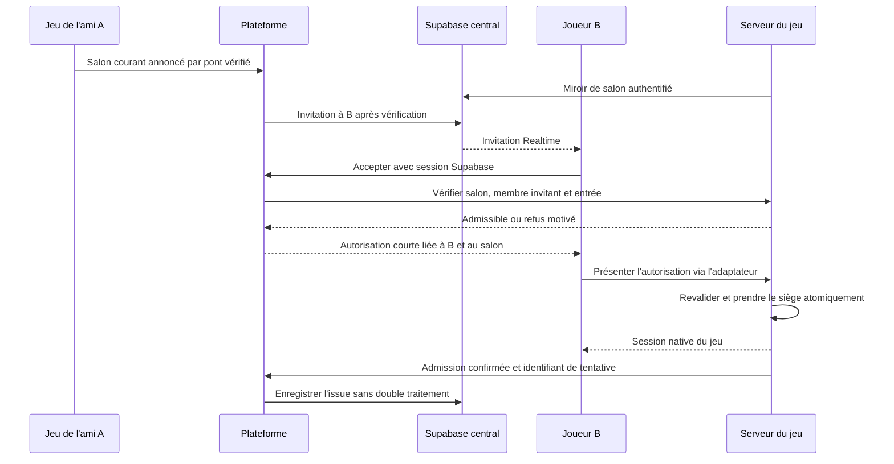

# Invitations directes et codes invités — audit préalable

Audit du 1er novembre 2026, depuis la plateforme `9658e2d`.
Branche de travail : `codex/direct-game-invitations-audit`.

Le socle social et les liens de salon existent déjà. Le parcours demandé n'est
cependant pas garanti de bout en bout : la plateforme ignore les salons créés
dans ses iframes, le registre central est vide, et une invitation acceptée ne
constitue pas une autorisation d'entrée vérifiée par le serveur du jeu.

Cet audit ne modifie aucun moteur, serveur, salon, règle, variable distante ou
migration. Aucun déploiement ni nouveau compte de production effectué. Seuls
ce rapport et un outil de reproduction SQL locale sont ajoutés à la plateforme.

## Périmètre et sources effectivement inspectées

Les cinq jeux activés dans `src/data/games.ts` ont été inspectés. Les douze titres
non activés ne sont pas des intégrations disponibles à valider : ils ne devront
être raccordés qu'après identification de leur version et de leur serveur réels.

| Jeu / slug | Dépôt GitHub et instantané audité | Architecture actuelle | Capacité du code serveur |
| --- | --- | --- | --- |
| Kilomax / `kilomax` | `Enroute`, `af3bc1f` ; copie locale de branche `cb82589` également consultée | Next.js sur Vercel ; salons et RPC dans le Supabase propre au jeu | 6 |
| La Meute / `la-meute` | `Leloupbo`, branche par défaut `d1b29ea` ; copie locale plus récente `8ca172b` consultée pour les protections portefeuille/auth | Node persistant, Socket.IO, moteur et sauvegardes de salons | `settings.maxPlayers`, plafond 18 |
| Quiz Master / `quiz-master` | `QuizzMaster`, `6e6df24` | Next.js + serveur Node WebSocket, salons en mémoire | 8 |
| Président / `president` | `presidente`, `7842bc7` | Next.js Node, API REST + SSE et repli polling | 8 |
| 10000 / `10000` | `lewisdee`, `5c6f3f4` | Node + WebSocket, salons en mémoire | 6 |

Les capacités proviennent des moteurs, et non des libellés parfois différents
du catalogue de la plateforme. Le connecteur devra publier ces valeurs réelles.
Les dépôts ont été copiés dans `/private/tmp/revanche-invitations-audit/` pour
lecture ; les dépôts locaux des jeux n'ont pas été modifiés.

Vérifications d'exploitation en lecture seule :

- Supabase central : `wrsmtdtzilpckfcjmyri`, fonctions d'invitation et publication
  Realtime effectivement inspectées. `room_registry` contient **zéro ligne** au
  moment du contrôle. Cela ne signifie pas qu'aucune partie n'existe dans les jeux.
- Railway : Président déploie `7842bc7` depuis
  `claude/le-president-online-build-wnuqaj` ; 10000 déploie `5c6f3f4` depuis `main`.
  La Meute (`village-des-blackops`) et Quiz Master sont en `SUCCESS`, mais leurs
  derniers déploiements ne fournissent pas de commit dans les métadonnées lues.
  Leur code actif ne peut donc pas être assimilé sans preuve à la branche GitHub
  par défaut. Conserver les protections de la version locale récente de La Meute.
- Vercel : `www.kilomax.fr` pointe sur le projet `enroute`, déploiement de
  production `dpl_2xgKYrNffuDpWm3dmiK4PFG2F55L`, **Ready**. Un alias comporte
  `claude-en-route-board-game-c6hqed` ; cela n'établit pas à lui seul le hash actif.
- Les cinq URL du catalogue répondent HTTP 200. Aucun remplacement `GAME_URL_*`
  n'est configuré sur le service plateforme lors de la lecture.
  Attention : le catalogue 10000 vise encore `lewisdee.onrender.com`, alors
  qu'un service Railway existe aussi. Identifier l'origine canonique avant de
  déployer son connecteur ; l'audit ne change pas cette destination.
- Quiz Master autorise explicitement l'iframe de la plateforme Railway dans son
  `frame-ancestors`. Pour une plateforme sur Vercel, il faudra ajouter son origine
  exacte après identification. Les quatre autres pages sondées n'exposent pas
  de restriction `X-Frame-Options`/CSP dans leurs réponses d'accueil.

## Parcours actuel dans la plateforme

1. Supabase Auth fournit l'identité, le profil et les relations `friendships`.
2. `InGameInviteDock` et `InviteFriendDialog` appellent `send_game_invitation`.
3. `SocialProvider` écoute `game_invitations` et `notifications` via Realtime.
   Ces deux tables et `friendships` sont bien dans la publication de production.
4. `InvitationToast` propose « Rejoindre » et « Refuser », y compris sur l'écran
   de jeu. Le premier libellé doit devenir « Accepter » pour la demande actuelle.
5. `respond_to_game_invitation` vérifie `auth.uid()`, le destinataire, le statut
   pending, l'expiration et, **si le salon est dans le registre**, son état et sa
   capacité. La fonction verrouille l'invitation, pas une place dans le jeu.
6. Le navigateur ouvre `/play/<slug>?room=<code>`. La page ajoute `rg_room` et un
   jeton d'identité HMAC `rg_token`, valable 30 minutes, à l'URL de l'iframe.
7. Le jeu interprète ces paramètres puis suit son protocole d'entrée habituel.

Références principales :

- `src/components/social/{SocialProvider,InvitationToast,InGameInviteDock,InviteFriendDialog}.tsx`
- `src/lib/social/api.ts`, `src/lib/platform-token.ts`
- `src/app/play/[slug]/page.tsx`
- `src/components/game/{GameSessionProvider,GameMount,GameViewport}.tsx`
- `supabase/migrations/20261026030000_social_core.sql`
- `supabase/migrations/20261026170000_friend_groups.sql` pour les invitations de groupe.

## Écarts à corriger avant l'intégration

### Le salon courant ne remonte pas de l'iframe

`ActiveGame.roomCode` est initialisé par le paramètre de lancement de la
plateforme. Aucun pont `postMessage` de salon n'a été trouvé dans la plateforme
ni les cinq instantanés GitHub. Un joueur qui ouvre normalement un jeu puis y
crée un salon conserve donc `roomCode=null` dans la coquille. Le bouton peut
envoyer une invitation sans salon : elle ouvre seulement le menu du jeu.

### Le registre n'est ni alimenté ni une preuve d'admission

Aucun producteur de `room_registry` n'a été trouvé dans ces cinq instantanés.
Le registre central est effectivement vide. Les fonctions SQL acceptent un code
absent du registre : l'absence n'est pas traitée comme un refus.

Il manque également un identifiant d'instance de salon, une date de dernière
activité, une expiration et la preuve que l'expéditeur est encore membre du
salon qu'il annonce. Un code réutilisé après fermeture doit désigner une autre
instance, même s'il a le même texte.

Le registre doit rester un miroir. Un contrôle de capacité dans ce miroir ne
réserve pas une place et peut devenir périmé avant l'arrivée dans le jeu.

### L'identité signée ne constitue pas un droit d'entrée

Le `rg_token` actuel porte `uid`, `username`, éventuellement `avatar`, `iat` et
`exp`. Il ne lie pas l'identité à un jeu, une invitation, un salon ou un usage
unique. `rg_room` est un paramètre indépendant que le navigateur peut modifier.

Les serveurs Node inspectés vérifient le jeton d'identité, mais leurs parcours
historiques peuvent traiter un jeton invalide comme un invité. Le code local
récent de La Meute contient déjà `requirePlatformIdentity` et un contrôle de
doublon d'identité : **ne pas les remplacer par l'ancienne version GitHub**.
Le futur chemin d'invitation devra refuser explicitement une autorisation
invalide ; le chemin manuel invité devra conserver sa politique propre.

Le jeton de lancement est actuellement dans une URL puis en `sessionStorage`.
Ne pas ajouter une autorisation longue durée ou un secret serveur à ce mécanisme.

### L'acceptation arrive avant l'admission réelle

La base marque l'invitation `accepted` avant que le serveur du jeu ait répondu.
Un échec réseau ou un refus laisse une invitation consommée sans joueur admis.
Le code de plusieurs clients efface aussi `rg_room` avant la confirmation de
connexion. Il faut séparer intention d'accepter et admission confirmée, permettre
la reprise d'une tentative légitime et garder l'anti-rejeu.

`GameSessionProvider` conserve l'iframe pendant la navigation, ce qui est utile.
Il faut le garder. En revanche, il compare le salon de lancement et ne connaît
pas ses changements internes ; séparer identité stable de l'iframe et salon
courant annoncé pour éviter de recharger une partie au retour dans la plateforme.

## Modifications nécessaires dans chaque jeu

| Dépôt | Points à adapter | Ce qui doit rester |
| --- | --- | --- |
| Plateforme `revanchegames` | Pont d'iframe dans `GameViewport` ; salon courant dans `GameSessionProvider` ; invitation dans les composants sociaux ; route serveur d'acceptation/admission ; lancement du jeu ; migrations additives du registre et des tentatives d'entrée ; lien push portant l'identifiant d'invitation | Auth, amis, Realtime, iframe persistante, notifications et groupes |
| `Enroute` | `game/lib/online/{api,actions,session,platformToken,platformRoom}.ts`, `JoinGate`, page online ; nouvelle route serveur d'admission ; RPC additive dans le Supabase propre au jeu ; annonce de salon depuis les RPC/serveur | `join_room` manuel, secret de siège, polling/Realtime, moteur 6 joueurs |
| `Leloupbo` | `public/js/{app,gameClient,platformRoom}.js`, `src/server/{app,gameManager,platform-token}.ts` et stockage existant ; adaptateur Socket.IO d'admission, mise à jour du registre après mutation confirmée | `game:create`, `game:join`, `session:resume`, règles, limites, sauvegardes, protections portefeuille et de compte récentes |
| `QuizzMaster` | `src/components/ui/Home.tsx`, `src/lib/{net,platformToken,platformRoom}.ts`, `server/game/{rooms,room}.ts`, `server/index.ts` ; nouveau message d'entrée autorisée et annonce de salon | WebSocket actuel, jeton de session, `resume`, moteur 8 joueurs |
| `presidente` | `HomeScreen`, `RoomScreen`/`JoinGate`, `useRoom`, `src/app/api/rooms/[code]/join/route.ts`, `src/server/{store,platform-token}.ts` ; entrée automatique pour le chemin autorisé et synchronisation du registre | API invités, SSE/polling, sessions locales, moteur 8 joueurs |
| `lewisdee` | `js/{main,net,platformRoom}.js`, `server.js`, `net/{rooms,platform-token}.js` ; admission authentifiée, synchronisation du registre, jeton de reprise du siège | Codes de 5 caractères, WebSocket `/ws`, protocole invités, moteur 6 joueurs |

Constats particuliers qui rendent insuffisante une simple modification d'URL :

- **Kilomax** : `JoinGate` préremplit le nom mais attend encore le clic sur son
  bouton. Le siège est lié à un `playerId` d'appareil et à un secret de membre ;
  `join_room(p_code,p_player_id,p_name)` ne vérifie pas le compte Revanche Games.
  Ajouter un chemin serveur qui vérifie l'autorisation et lie le compte au siège,
  sans remplacer le projet Supabase ou ouvrir l'accès aux secrets des membres.
- **Président** : `HomeScreen` dirige vers `/salle/<code>`, puis `RoomScreen`
  affiche encore `JoinGate` sans session. Ce second écran n'appelle pas
  automatiquement l'API d'entrée. Il faut raccorder la nouvelle admission au
  stockage de session avant d'afficher la table.
- **Quiz Master** : l'auto-entrée utilise `resolvedName` du profil local, et pas
  le pseudonyme du compte sur un appareil neuf. La lecture du pseudonyme signé
  est aujourd'hui utilisée séparément pour l'affichage.
- **La Meute** : la voie d'auto-entrée existe déjà si un nom est résolu. Conserver
  sa distinction entre profil propre au jeu, compte central et invité, ainsi que
  son vrai mécanisme de reprise de session. Version déployée à établir avant patch.
- **10000** : auto-entrée présente avec pseudonyme de plateforme ; le transport
  inspecté ne propose pas de message `resume` ni de jeton de siège. Une coupure
  après démarrage ne permet pas de refaire un `join`, qui est interdit une fois
  la partie commencée. Une reprise doit retrouver le même siège sans autoriser
  un nouveau joueur à entrer en cours de partie.

## Contrat proposé pour le connecteur commun

Un même protocole applicatif avec des adaptateurs aux transports existants.
Railway et Vercel ne deviennent pas les gestionnaires des salons : les jeux
gardent leurs moteurs et leur autorité. Kilomax conserve ses RPC Supabase.



1. **Pont navigateur versionné.** Messages communs `ready`, `room-state`,
   `invite-request`, `join-authorized`, `joined`, `left`, `join-error` ; schémas
   bornés et validation du `slug`, de l'instance et du code. Vérifier à la fois
   `event.origin` et `event.source === iframe.contentWindow`, utiliser un
   `targetOrigin` exact et un identifiant de lancement. Le pont donne un contexte
   d'interface ; il n'autorise jamais seul l'envoi d'une invitation ou l'entrée.
2. **Usage autonome.** Dans un jeu ouvert sans coquille, le bouton « Inviter un
   ami » doit ouvrir la plateforme canonique avec un contexte opaque émis par
   le serveur du jeu, puis laisser Supabase Auth vérifier le compte et son siège.
   Conserver ce contexte à travers la connexion, sans redirection externe libre.
   Pas de dépendance aux cookies tiers, pas de copie du refresh token Supabase
   dans les jeux. Depuis une iframe, ouvrir le sélecteur d'amis existant.
3. **Registre alimenté par les serveurs.** Création, entrée, départ, paramètres,
   début et fermeture publient un état confirmé. Ajouter instance UUID,
   fraîcheur/expiration, version d'état et indicateurs d'admission ; ne pas y
   publier les secrets de siège ni les rôles des joueurs. Vérifier l'appartenance
   de l'invitant côté jeu. Des secrets propres à chaque jeu ou des signatures
   serveur authentifient la publication : pas de `service_role` dans le navigateur.
4. **Acceptation côté serveur.** Session vérifiée avec `getUser()`, compte réel
   identifié, destinataire, amitié/blocage actuels, expiration, état pending ou
   tentative réessayable, jeu autorisé et salon exact. Le serveur du jeu vérifie
   son état réel, la capacité et les conditions déjà définies par ses règles.
   Refuser un salon absent, périmé ou non vérifiable pour les invitations directes.
5. **Autorisation distincte de l'identité.** Jeton signé versionné, proposé pour
   60 secondes, avec `iss`, `aud` du jeu, `uid`, invitation, instance de salon,
   tentative, `iat`, `exp`, `jti`. Clé privée conservée sur la plateforme et clé
   publique dans les adaptateurs serveur ; aucune clé privée dans les jeux.
   Transmettre après handshake d'iframe, pas comme autorisation permanente en URL.
6. **Admission autoritaire et idempotente.** Le jeu vérifie la signature,
   l'audience, le salon et l'expiration, puis revalide et réserve/crée le siège
   atomiquement au moment de l'entrée. Empêcher les doubles sièges pour un compte
   et le rejeu de `jti`. Si une réponse est perdue, une reprise authentifiée de la
   même tentative retrouve le résultat sans créer une nouvelle place. Un contrôle
   préalable suivi d'un simple `join` non atomique ne résout pas la dernière place.
7. **Issue et reconnexion.** Stocker séparément acceptation, tentative et résultat
   d'admission ; confirmation serveur authentifiée et réessayable. Ne pas prétendre
   à une transaction distribuée entre le jeu et Supabase. Si une pré-réservation
   est nécessaire, elle expire et peut être libérée après échec. Après succès,
   utiliser la session native de reprise du jeu, pas rejouer l'invitation expirée.
8. **Invités externes.** Garder les formulaires de code et leurs contrôles actuels.
   Absence de compte sur cette voie ne déclenche aucune obligation de connexion.
   Une invitation de compte invalide ne doit pas basculer silencieusement vers
   cette voie et perdre l'identité du joueur.

Une panne du connecteur bloque une nouvelle invitation avec une erreur claire,
sans interrompre les parties en cours ni casser les codes invités existants.
Le connecteur utilise des requêtes serveur courtes ; aucun déplacement des
serveurs persistants ou remplacement de WebSocket/SSE n'est nécessaire.

## Recette : ce qui est réellement vérifié

Commande reproductible dans le dépôt plateforme :

```sh
node scripts/audit-invitations.mjs
```

Neuf constats reproduits sur PGlite avec les migrations existantes : expéditeur
non ami refusé, autre destinataire refusé sous `authenticated`, expiration
refusée, refus enregistré, salon rempli entre envoi et acceptation refusé,
salon démarré refusé ; trois défauts reproduits : salon absent accepté,
acceptation sans admission/réservation, seconde acceptation pour la dernière place.
Le marqueur `GAP` du script signale un défaut constaté, pas une validation de sécurité.
Ce script d'audit devra être remplacé ou ajusté après correction : il constate
volontairement le comportement actuel.

Quatre vérifications supplémentaires ont été exécutées sur le vrai
`RoomManager` de 10000 avec des sockets simulés : invité sans compte admis par
code, code inconnu refusé, salon complet refusé, partie commencée refusée.
Ce ne sont ni un parcours navigateur ni un test WebSocket distant.

Les deux identités PostgreSQL des tests **ne sont pas deux comptes Supabase
connectés dans des navigateurs**. Aucun parcours réel à deux comptes n'a été
exécuté pendant cet audit. Aucun résultat E2E n'est revendiqué.

## Tests à exécuter après intégration, pour chacun des cinq jeux

| Scénario | Critère d'acceptation |
| --- | --- |
| Deux comptes A/B distincts, déjà amis | A crée un salon dans le jeu, invite B ; B reçoit Accepter/Refuser, accepte et voit directement le bon salon, identité serveur B conservée, aucun code ni confirmation supplémentaire |
| Depuis la plateforme et depuis le jeu autonome | Même parcours, y compris après connexion Supabase si nécessaire ; contexte de salon conservé |
| Invité externe | Sans compte, saisie manuelle du code, entrée si les règles du jeu l'autorisent, sans redirection forcée vers inscription |
| Salon inexistant, fermé ou instance remplacée | Refus avant émission/usage de l'autorisation, message explicite, pas de siège créé |
| Salon complet | Refus côté serveur du jeu ; aucun dépassement de sa capacité réelle |
| Dernière place disputée entre deux invitations | Deux acceptations concurrentes : une admission au maximum, l'autre refusée ; le miroir central n'arbitre pas la capacité |
| Partie démarrée | Pas de nouvel entrant ; un ancien membre peut seulement reprendre selon les règles actuelles |
| Invitation expirée, refusée, annulée ou adressée à un autre compte | Aucune entrée ni ticket utilisable ; RLS et route serveur vérifiées |
| Jeton altéré, expiré, autre jeu/salon/compte, rejeu | Refus explicite, aucun repli silencieux en invité |
| Coupure après réservation ou perte de confirmation | Reprise idempotente, aucun siège doublé, pré-réservation libérée si abandon |
| Reconnexion réseau et rafraîchissement | Même compte et même siège avec session native ; 10000 doit disposer de sa nouvelle reprise |
| Navigation profil/amis puis retour au jeu | Connexion et partie existantes conservées ; pas de rechargement provoqué par le simple suivi du salon |
| iPhone, Android, ordinateur, PWA | Boutons utilisables au tactile/clavier, stockage indisponible géré, retour de veille et reprise testés sur appareils/navigateurs réels |
| Application fermée / push | Notification persistante à la réouverture ; support push testé séparément, sans assimiler WebSocket suspendu à du temps réel en arrière-plan |

Sur iPhone, le push hors application doit être distingué des invitations Realtime
quand l'application est ouverte. Prévoir le parcours PWA installée et permission
push, sans promettre deux actions système identiques sur tous les navigateurs :
les boutons Accepter/Refuser restent disponibles dans l'application.

## Ordre d'intégration proposé

1. Identifier et figer les versions réellement servies de La Meute, Quiz Master,
   Kilomax et l'origine effective de 10000 ; conserver les changements locaux.
2. Ajouter le contrat commun et ses tests (signatures, audiences, schémas,
   idempotence), sans toucher aux moteurs ou aux routes invitées.
3. Étendre le registre et les tentatives par migrations additives, puis raccorder
   les publications serveur et le pont navigateur derrière activation par jeu.
4. Ajouter l'admission serveur et la reprise de 10000 ; traiter Kilomax par une
   RPC dédiée avec verrou de salon et identité vérifiée par sa route serveur.
5. Raccorder l'interface existante et les invitations de groupes au même service
   d'admission ; supprimer le code à saisir uniquement dans ce parcours de compte.
6. Exécuter la matrice avec deux comptes de test et un invité dans des salons
   isolés, puis les vérifications mobile/PWA et de non-régression des jeux.
7. Déployer chaque adaptateur en conservant sa compatibilité, puis activer le
   parcours sur la plateforme jeu par jeu ; retour arrière par désactivation du
   nouveau parcours, sans suppression de données ou modification des règles.

## Références techniques

- [Supabase : Postgres Changes et RLS](https://supabase.com/docs/guides/realtime/postgres-changes)
- [MDN : contrôle de source et d'origine avec postMessage](https://developer.mozilla.org/en-US/docs/Web/API/Window/postMessage)
- [WebKit : Web Push pour les applications installées sur iOS/iPadOS](https://webkit.org/blog/13878/web-push-for-web-apps-on-ios-and-ipados/)

Les constats sur Revanche Games proviennent du code et des commandes décrites
ci-dessus ; ces références documentent les mécanismes utilisés dans la proposition.
